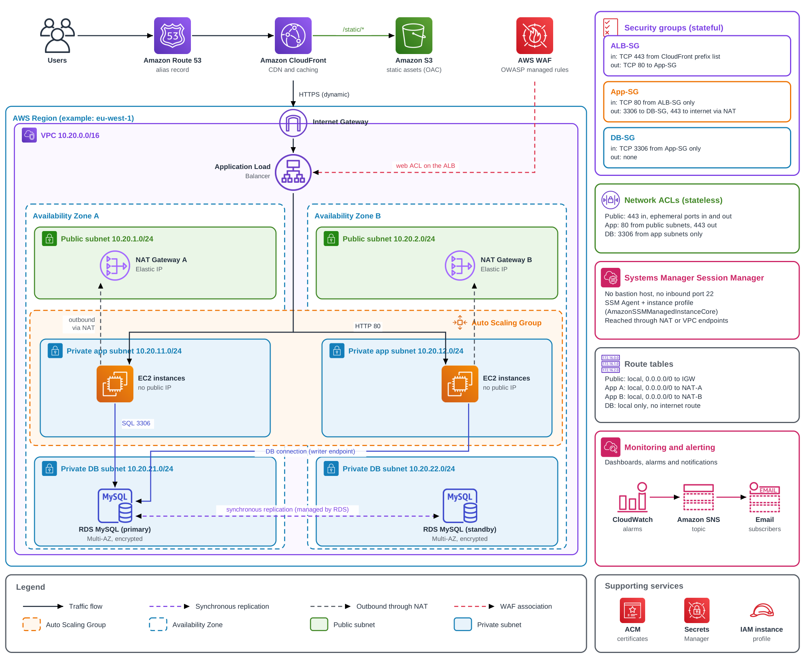
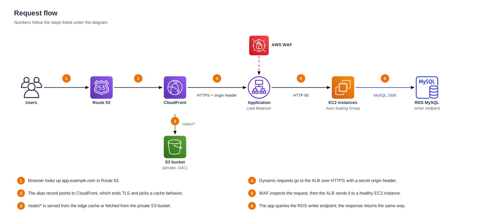
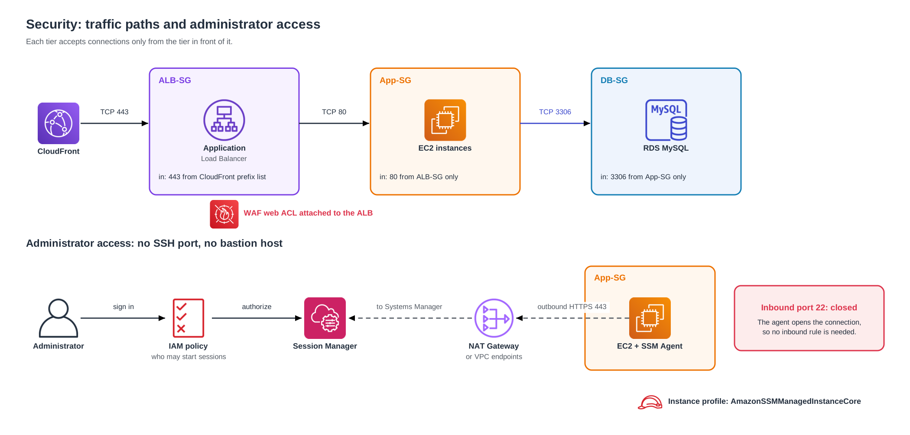

# Scalable Web Application on AWS: ALB, Auto Scaling, CloudFront and Multi-AZ RDS

This project is a web application on AWS that keeps running if an Availability Zone goes down and grows or shrinks with the load. The servers and the database sit in private subnets across two AZs. Users reach the app through Route 53, CloudFront and an Application Load Balancer with AWS WAF in front of it, and I use Session Manager instead of a bastion host to get into the instances.

## Table of contents

1. [Solution overview](#1-solution-overview)
2. [Architecture diagram](#2-architecture-diagram)
3. [Request flow](#3-request-flow)
4. [Network design](#4-network-design)
5. [Security design](#5-security-design)
6. [Compute: Launch Template, Auto Scaling and ALB](#6-compute-launch-template-auto-scaling-and-alb)
7. [Edge: CloudFront, WAF and Route 53](#7-edge-cloudfront-waf-and-route-53)
8. [Database: RDS Multi-AZ](#8-database-rds-multi-az)
9. [Monitoring and notifications](#9-monitoring-and-notifications)
10. [Implementation order](#10-implementation-order)
11. [Validation](#11-validation)
12. [Learning outcomes](#12-learning-outcomes)

---

## 1. Solution overview

The design is built around a few goals. For availability, the subnets, NAT Gateways, load balancer nodes, instances and the RDS standby are all split across two AZs. For scaling, an Auto Scaling Group adds and removes instances using target tracking and step scaling policies. For security, the instances and the database stay private, the security groups only allow traffic from the tier in front of them, and WAF and NACLs add extra layers on top. Static files are cached by CloudFront from a private S3 bucket, and Route 53 gives the app a friendly domain name with a health check behind it. For day-to-day operation there are CloudWatch alarms that send email alerts through SNS.

### Services used

| Area | Services |
|---|---|
| Networking | VPC, subnets, route tables, Internet Gateway, NAT Gateways, security groups, network ACLs |
| Compute | EC2, Launch Template, Auto Scaling Group |
| Load balancing | Application Load Balancer, target group |
| Edge and DNS | CloudFront, S3, Route 53, AWS Certificate Manager |
| Protection | AWS WAF, IAM, Secrets Manager |
| Database | RDS for MySQL (Multi-AZ DB instance) |
| Operations | Systems Manager Session Manager, CloudWatch, SNS |

### Design principles

- Every tier spans two Availability Zones: load balancer nodes, NAT Gateways, application capacity and the database.
- Instances have no public IPv4 address and the database subnets have no internet route.
- The Auto Scaling Group adds capacity under load and replaces instances that fail load balancer health checks.
- Security comes from several layers (WAF, CloudFront, security groups, NACLs, IAM, IMDSv2, encryption) rather than one control.
- RDS Multi-AZ handles replication and promotion, so there is no hand-built database failover.
- Session Manager replaces SSH, and IAM decides who can start a session.
- Each tier has metrics and alarms that end up in an email inbox.

## 2. Architecture diagram

*Figure 1: solution architecture.*

[Open the editable architecture diagram in draw.io](https://app.diagrams.net/#Uhttps%3A%2F%2Fraw.githubusercontent.com%2FAlaaGomaa178%2FScalable-Web-Application-with-ALB-and-Auto-Scaling%2Fmain%2Farchitecture%2Farchitecture-diagram.drawio)

[View the source draw.io file](architecture/architecture-diagram.drawio)

The ALB health checks use the same HTTP 80 path as normal traffic (`/health`), and the standby database in AZ B is only used after a failover.

## 3. Request flow

*Figure 2: path of a request from the browser to the database.*

[Open the editable security layers diagram in draw.io](https://app.diagrams.net/#Uhttps%3A%2F%2Fraw.githubusercontent.com%2FAlaaGomaa178%2FScalable-Web-Application-with-ALB-and-Auto-Scaling%2Fmain%2Farchitecture%2Fsecurity-layers.drawio)

[View the source draw.io file](architecture/security-layers.drawio)

1. A user opens `app.example.com`. Route 53 resolves the name with an alias record to the CloudFront distribution.
2. CloudFront matches the request to a cache behavior:
   - `/static/*` is served from the private S3 bucket (cached at the edge, accessed through Origin Access Control).
   - Everything else is a dynamic request and is forwarded to the ALB origin with caching disabled.
3. The request reaches the ALB over HTTPS. The ALB only accepts traffic from CloudFront (security group rule plus a secret origin header, see [section 7](#7-edge-cloudfront-waf-and-route-53)). AWS WAF is associated with the ALB and inspects the request first.
4. The ALB listener rule forwards the request to the target group, which sends it to a healthy EC2 instance in a private app subnet over HTTP port 80.
5. When the application needs data, it connects to the RDS writer endpoint on port 3306.
6. The response returns the same way. Instances in private subnets reach the internet (OS updates, package installs, Systems Manager) only through the NAT Gateway in their own AZ.

## 4. Network design

| Network | CIDR | AZ | Purpose |
|---|---|---|---|
| VPC | `10.20.0.0/16` | n/a | Address space (DNS resolution and hostnames enabled) |
| Public subnet A | `10.20.1.0/24` | A | ALB node, NAT Gateway A |
| Public subnet B | `10.20.2.0/24` | B | ALB node, NAT Gateway B |
| Private app subnet A | `10.20.11.0/24` | A | EC2 instances |
| Private app subnet B | `10.20.12.0/24` | B | EC2 instances |
| Private DB subnet A | `10.20.21.0/24` | A | RDS |
| Private DB subnet B | `10.20.22.0/24` | B | RDS |

| Route table | Associated subnets | Routes |
|---|---|---|
| `rt-public` | Public A and B | `10.20.0.0/16` local; `0.0.0.0/0` to Internet Gateway |
| `rt-app-a` | Private app A | `10.20.0.0/16` local; `0.0.0.0/0` to NAT Gateway A |
| `rt-app-b` | Private app B | `10.20.0.0/16` local; `0.0.0.0/0` to NAT Gateway B |
| `rt-db` | Private DB A and B | `10.20.0.0/16` local only |

The Internet Gateway serves the public subnets (ALB nodes, NAT Gateways). Each NAT Gateway lets instances in its AZ start outbound connections for updates and Systems Manager, but nothing on the internet can start a connection to them. One NAT Gateway per AZ keeps outbound access alive if an AZ fails and avoids cross-AZ NAT traffic. The database subnets have no internet route.

## 5. Security design

*Figure 3: how traffic and administrator access are restricted.*

[Open the editable security layers diagram in draw.io](https://app.diagrams.net/#Uhttps%3A%2F%2Fraw.githubusercontent.com%2FAlaaGomaa178%2FScalable-Web-Application-with-ALB-and-Auto-Scaling%2Fmain%2Farchitecture%2Fsecurity-layers.drawio)

[View the source draw.io file](architecture/security-layers.drawio)

### 5.1 Security groups

Security groups are stateful, and internal rules reference other security groups instead of CIDR ranges.

| Security group | Inbound | Outbound |
|---|---|---|
| `alb-sg` | TCP 443 from the CloudFront managed prefix list `com.amazonaws.global.cloudfront.origin-facing` | TCP 80 to `app-sg` |
| `app-sg` | TCP 80 from `alb-sg` | TCP 3306 to `db-sg`; TCP 443 to `0.0.0.0/0` (updates and Systems Manager through NAT) |
| `db-sg` | TCP 3306 from `app-sg` | None needed |

The CloudFront prefix list counts toward the security group rule quota, so check the quota before attaching it. No rule opens SSH (port 22).

### 5.2 Network ACLs

NACLs are stateless, so every rule needs a matching return path (ephemeral ports 1024-65535). They sit behind the security groups as a second layer.

| NACL | Inbound | Outbound |
|---|---|---|
| Public subnets | TCP 443 from `0.0.0.0/0`; TCP 1024-65535 from `0.0.0.0/0`; TCP 443 from the two app subnets (NAT traffic) | TCP 443 to `0.0.0.0/0`; TCP 80 to the two app subnets; TCP 1024-65535 to `0.0.0.0/0` |
| Private app subnets | TCP 80 from the two public subnets; TCP 1024-65535 from `0.0.0.0/0` (replies via NAT and from the database) | TCP 443 to `0.0.0.0/0`; TCP 3306 to the two DB subnets; TCP 1024-65535 to the two public subnets |
| Private DB subnets | TCP 3306 from the two app subnets | TCP 1024-65535 to the two app subnets |

Added them once the application works with the default NACL, then retested health checks, package downloads and database access. 

### 5.3 AWS WAF

A regional web ACL is associated with the ALB, with these rules in priority order:

| Priority | Rule | Purpose |
|---|---|---|
| 1 | `AWSManagedRulesAmazonIpReputationList` | Known malicious sources |
| 2 | `AWSManagedRulesCommonRuleSet` | Common exploits (XSS, path traversal, bad request patterns) |
| 3 | `AWSManagedRulesKnownBadInputsRuleSet` | Known exploit patterns such as Log4j-style payloads |
| 4 | `AWSManagedRulesSQLiRuleSet` | SQL injection |
| 5 | Rate-based rule | Throttle abusive clients |

Because CloudFront sits in front of the ALB, the rate-based rule has to use the client IP from the `X-Forwarded-For` header (forwarded IP configuration), otherwise every request looks like it comes from CloudFront. Start each rule in Count mode, check the sampled requests, then switch to Block. Managed rules cover many OWASP Top 10 categories but not all of them, so the application still has to validate input.

### 5.4 Access, encryption and secrets

- The EC2 instance profile has `AmazonSSMManagedInstanceCore` plus a small policy that can read only the database secret.
- Session Manager replaces SSH. The SSM Agent reaches Systems Manager through the NAT Gateways, or through interface endpoints for `ssm`, `ssmmessages` and `ec2messages` if you want to avoid the internet path. IAM policies control who can start a session.
- RDS storage, snapshots and EBS volumes are encrypted. The RDS master password is managed by Secrets Manager (`--manage-master-user-password`), so no password appears in code or in this repository.
- Traffic is HTTPS from the viewer to CloudFront and from CloudFront to the ALB, using ACM certificates. IMDSv2 is required on every instance.

## 6. Compute: Launch Template, Auto Scaling and ALB

### 6.1 Launch Template (`lt-web`)

| Setting | Value |
|---|---|
| AMI | Latest Amazon Linux 2023 (SSM parameter `/aws/service/ami-amazon-linux-latest/al2023-ami-kernel-default-x86_64`) |
| Instance type | `t3.micro` (for eexample) |
| Security group | `app-sg` |
| IAM instance profile | SSM + secret-read role |
| Public IP | Not assigned (private subnets) |
| EBS | Encrypted gp3 root volume |
| Metadata options | IMDSv2 required |
| Tags | `Project`, `Environment`, `Owner` |

### 6.2 Auto Scaling Group (`asg-web`)

| Setting | Value |
|---|---|
| Subnets | Private app A and B |
| Capacity | Min 2, desired 2, max 4 (example) |
| Target group | `tg-web` attached |
| Health checks | EC2 and ELB (so instances failing the load balancer check are replaced) |
| Health check grace period | 300 seconds |
| Instance warm-up | 120 seconds |
| AZ rebalancing | Enabled (default) |
| Group metrics | Enabled (needed for `GroupInServiceInstances` and `GroupDesiredCapacity` in CloudWatch) |

With a minimum of two instances in two AZs, losing one AZ leaves one instance serving traffic while the ASG launches replacements in the surviving AZ.

### 6.3 Scaling policies

| Policy | Type | Configuration |
|---|---|---|
| `requests-per-target` | Target tracking | Metric `ALBRequestCountPerTarget`, target value chosen from load testing (for example 500 requests per target per minute) |
| `cpu-step-out` | Step scaling | CloudWatch alarm on average ASG CPU: above 70% add 1 instance, above 85% add 2 instances |

Target tracking handles both scale-out and scale-in around a steady target. The step policy adds faster, graduated reaction to CPU saturation. Scale-in stays under target tracking only. 

### 6.4 Application Load Balancer

| Item | Configuration |
|---|---|
| Scheme and subnets | Internet-facing, public subnets A and B |
| Security group | `alb-sg` |
| Target group `tg-web` | Target type `instance`, HTTP 80 |
| Health check | Path `/health`, success code 200, interval 15 s, healthy threshold 3, unhealthy threshold 2 |
| Listener | HTTPS 443 with an ACM certificate for the origin hostname (for example `origin.example.com`) |
| Rule 1 (priority 1) | If header `X-Origin-Verify` equals the secret value, forward to `tg-web` |
| Default action | Fixed response 403 |

Rule 1 plus the 403 default is Layer 7 routing that makes the ALB refuse anyone who bypasses CloudFront, even if they know the ALB DNS name.

## 7. Edge: CloudFront, WAF and Route 53

### 7.1 CloudFront distribution

| Item | Configuration |
|---|---|
| Alternate domain name | `app.example.com` with an ACM certificate in us-east-1 |
| Origin 1 | ALB at `origin.example.com`, HTTPS only, custom header `X-Origin-Verify: <secret>` |
| Origin 2 | Private S3 bucket with Origin Access Control |
| Behavior `/static/*` | Origin 2, managed policy `CachingOptimized`, redirect HTTP to HTTPS |
| Default behavior | Origin 1, managed policy `CachingDisabled`, origin request policy `AllViewerExceptHostHeader`, all HTTP methods allowed |
| Viewer protocol | Redirect HTTP to HTTPS, TLS 1.2 minimum |

The S3 bucket keeps Block Public Access on. Its bucket policy allows only the CloudFront service principal for this specific distribution (`AWS:SourceArn` condition).

### 7.2 Route 53

| Record | Type | Target |
|---|---|---|
| `app.example.com` | Alias A (and AAAA if IPv6 is enabled) | CloudFront distribution |
| `origin.example.com` | Alias A | ALB, evaluate target health enabled |

A Route 53 health check monitors `https://app.example.com/health`, so it exercises the whole path (CloudFront, WAF, ALB, instance). Route 53 health check metrics are published in `us-east-1`, so the alarm and SNS topic for that check must also be created in `us-east-1`.

### 7.3 Certificates

| Certificate | Region | Used by |
|---|---|---|
| `app.example.com` | us-east-1 | CloudFront |
| `origin.example.com` | Region of the ALB | ALB HTTPS listener |

## 8. Database: RDS Multi-AZ

| Setting | Value |
|---|---|
| Engine | MySQL 8.4  |
| Deployment | **Multi-AZ DB instance** |
| Class and storage | `db.t3.micro`, gp3, storage autoscaling optional (example sizing, choose by workload) |
| DB subnet group | Private DB subnets A and B |
| Public access | No |
| Security group | `db-sg` |
| Encryption | Enabled |
| Backups | Automated, 7-day retention, point-in-time recovery |
| Credentials | Managed in Secrets Manager |
| Deletion protection | On for anything beyond a lab |

How failover behaves:

- The primary serves reads and writes. AWS keeps a standby in the other AZ and replicates to it synchronously.
- On a primary failure, maintenance event or forced failover, RDS promotes the standby and moves the endpoint DNS name to it, typically within a minute or two.
- The application must use the endpoint DNS name (never an IP) and reconnect after interruptions, so connection retry logic is required.
- The standby is for availability, not extra read capacity. If read scaling is needed, add read replicas.

## 9. Monitoring and notifications

### 9.1 What is monitored

| Source | Metrics |
|---|---|
| ALB | `HTTPCode_Target_5XX_Count`, `TargetResponseTime`, `UnHealthyHostCount`, `HealthyHostCount`, `RequestCount` |
| Auto Scaling | `GroupInServiceInstances`, `GroupDesiredCapacity`, average `CPUUtilization` |
| EC2 | `CPUUtilization`, status checks (memory and disk require the CloudWatch Agent) |
| RDS | `CPUUtilization`, `DatabaseConnections`, `FreeStorageSpace`, `ReadLatency`, `WriteLatency` |
| CloudFront / WAF | Requests, error rates, cache hit rate, allowed and blocked requests |
| Route 53 | Health check status (us-east-1) |

### 9.2 Alarms (all notify the SNS topic `web-alerts`)

| Alarm | Condition (example) |
|---|---|
| No healthy targets | `HealthyHostCount` < 1 for 2 consecutive minutes |
| High 5xx errors | `HTTPCode_Target_5XX_Count` above a threshold for 5 minutes |
| Slow responses | Average `TargetResponseTime` above 1 second for 5 minutes |
| High CPU | ASG average CPU above 80% for 10 minutes |
| RDS low storage | `FreeStorageSpace` below 10 GB |
| RDS connections | `DatabaseConnections` above 80% of the instance limit |
| RDS failover | RDS event subscription for the `failover` category, delivered to the SNS topic |
| Endpoint down | Route 53 health check failing |

## 10. Implementation order

1. Network: VPC, six subnets, Internet Gateway, two NAT Gateways with Elastic IPs, route tables (section 4).
2. Security groups and the instance IAM role (section 5), custom NACLs later.
3. RDS subnet group and the Multi-AZ database (section 8).
4. ACM certificate, target group, ALB, HTTPS listener and header rule (section 6.4).
5. Launch Template with the Auto Scaling Group and scaling policies (sections 6.1 to 6.3).
6. S3 bucket, CloudFront distribution, WAF web ACL (Count mode first) and Route 53 records (section 7).
7. SNS topic, alarms and dashboard (section 9), then NACLs and a final test pass.

## 11. Validation

| Test | How | Expected result |
|---|---|---|
| Entry point and balancing | Open `https://app.example.com` and refresh several times | Valid certificate; the page shows different instance IDs in both AZs |
| Target health and isolation | `aws elbv2 describe-target-health --target-group-arn <tg-arn>`; check instance details | All targets `healthy`; no public IPv4 on instances; calling the ALB DNS name directly is blocked or returns 403 |
| Session Manager and database | `aws ssm start-session --target <instance-id>`, then `mysql -h <rds-endpoint> -u <user> -p` | Shell opens without SSH; database reachable from the app tier only and not publicly accessible |
| Caching and WAF | Request `/static/<file>` twice and read `X-Cache`; send `/?q=` | Second static request is a cache hit; the test pattern is counted or blocked and shows in sampled requests |
| Scaling and self-healing | Generate load with `ab` or `hey`; terminate one instance | Capacity grows up to the maximum; the ASG replaces the terminated instance |
| Database failover and alerting | `aws rds reboot-db-instance --db-instance-identifier <id> --force-failover` (test environment only); put an alarm in ALARM state | Standby is promoted and the app reconnects through the same endpoint; an email arrives from SNS |

## 12. Learning outcomes

- VPC with correct subnets, route tables and NAT Gateways (section 4)
- High availability across two AZs (sections 2, 4, 6, 8)
- ALB listener rules and target group health checks (section 6.4)
- Auto Scaling with target tracking and step scaling (sections 6.2 and 6.3)
- WAF, security groups and private subnets (section 5)
- Session Manager instead of a bastion host (section 5.4)